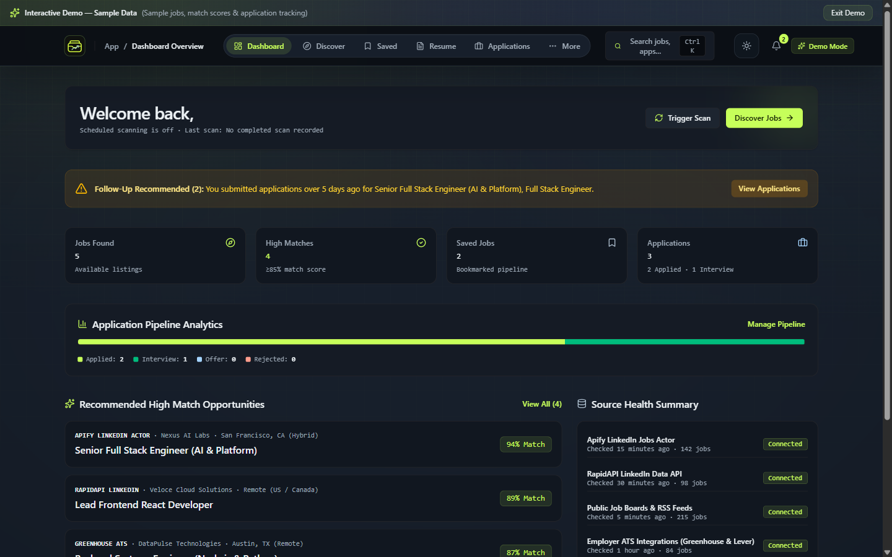
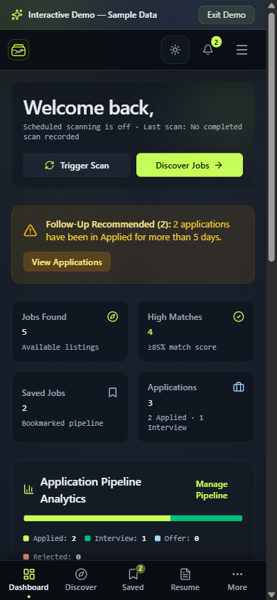

<div align="center">
  
  <h1>Agentic Jobs</h1>
  <p><strong>AI-assisted job discovery · Resume intelligence · Application tracking</strong></p>
  <p>
    <a href="https://agenticjobs.netlify.app/"></a>
    <a href="https://github.com/Talha-dotcom-hub/Agentic-Jobs/actions/workflows/ci.yml"></a>
  </p>
  <p>
    
    
    
    
    
    
    
    
  </p>
</div>

---

## Overview

**Agentic Jobs** is a full-stack job discovery and career workflow application. It combines resume-aware candidate profiles, configurable job sources, AI-assisted role matching, saved opportunities, application tracking, scheduled discovery, and notifications in one responsive Progressive Web App.

The product is designed to help people make better-informed decisions during a job search. It does not submit applications automatically: users review opportunities and apply themselves through the original employer or job-provider link.

> **Matching is decision support, not a hiring prediction.** Scores depend on available resume evidence, job descriptions, configured AI access, and provider data. They are not guarantees of interviews or employment.

## Product preview

The screenshots below show the interactive demo UI with clearly identified sample records. They are product-interface previews, not evidence of live job-provider results or production user data.

| Desktop · 1440 × 900 | Mobile · 390 × 844 |
|---|---|
|  |  |

<p align="center"><a href="https://agenticjobs.netlify.app/"><strong>Open Agentic Jobs ↗</strong></a></p>

## Core capabilities

- **Resume intelligence:** ingest supported PDF, DOCX, and text resumes; extract career evidence for profile-aware discovery.
- **AI-assisted matching:** evaluate role alignment with Gemini and surface relevant evidence and potential skill gaps.
- **Multi-source discovery:** normalize opportunities from supported public feeds and configured ATS/provider integrations.
- **Personal AI credentials:** support a bring-your-own-key workflow with backend-side credential protection.
- **Scheduled scans:** enqueue and process discovery work through the backend scheduler/worker when infrastructure is configured.
- **Saved jobs and application tracking:** organize opportunities and track application progress.
- **Notifications and Web Push:** support in-app updates and browser push when the required permissions and backend configuration are present.
- **Installable PWA:** provide a responsive app shell, install guidance, and offline-aware behavior.
- **Separate demo experience:** explore interface flows with clearly marked sample data, without confusing demo records for live vacancies.

## How it works

1. A user signs in and creates a career profile using a supported resume.
2. Resume processing extracts skills, experience, education, and other available evidence.
3. The user configures AI credentials, job preferences, and an optional scan schedule.
4. The backend discovers listings from the sources enabled by the deployment.
5. Listings are normalized and deduplicated; AI matching is performed when valid credentials and model access are available.
6. Results and scan state are persisted for the signed-in user.
7. The user reviews roles, follows original application links, saves opportunities, and tracks applications.

A recommendation threshold of **85% or higher** is used by the current product logic for validated numeric match scores. Failed or missing evaluations must not be represented as successful matches.

## Technology

| Area | Implementation |
|---|---|
| Frontend | React 19, TypeScript, Vite 8 |
| UI | Tailwind CSS 4, Motion, Lucide React |
| API | Node.js, Express 4 |
| Persistence and identity | Supabase Auth, PostgreSQL, Storage, Row Level Security |
| AI | Google Gemini through `@google/genai` |
| Resume processing | PDF.js, Mammoth (DOCX), text processing |
| Job discovery | Public feeds, configurable ATS integrations, optional Apify/RapidAPI connectors |
| Scheduling | Durable Supabase-backed scan queue and worker |
| Notifications | Web Push, VAPID, service worker |
| Quality checks | TypeScript type-check, Node test runner, production build, GitHub Actions CI |
| Hosting model | Netlify frontend with separately hosted Express API/worker |

## Architecture

```text
Browser / PWA
    │
    ├── React + Vite application
    │       ├── Authentication and profile
    │       ├── Resume and matching workflows
    │       ├── Discovery, saved jobs, applications
    │       └── Schedule, settings, notifications
    │
    └── HTTPS API
            ├── Express routes and request security
            ├── Resume parsing and Gemini orchestration
            ├── Job-source connectors and normalization
            ├── Scheduler and durable scan queue
            └── Supabase Auth / PostgreSQL / Storage
```

The frontend and backend are separate deployment concerns. Vite produces static assets in `dist/`; the Express API is built separately. Elevated Supabase credentials, provider tokens, encryption keys, and VAPID private keys belong only in the backend secret environment. Private user data must remain scoped to the authenticated user through server authorization and Supabase policies.

## Local development

### Requirements

- Node.js 24 or 26 and npm.
- A Supabase project for real authentication and persistence.
- A Gemini API key for AI matching.
- Optional provider credentials for additional job sources.
- Backend environment configuration for secure credential storage and scheduled work.

### Install

```bash
git clone https://github.com/Talha-dotcom-hub/Agentic-Jobs.git
cd Agentic-Jobs
npm ci
```

### Configure environment

Copy the example file and add only the values needed for your local setup.

**Windows PowerShell**

```powershell
Copy-Item .env.example .env
```

**macOS / Linux**

```bash
cp .env.example .env
```

See [`.env.example`](.env.example) for variable names and [Environment variables](#environment-variables) below for the security boundary. The example file contains placeholders, not working credentials.

### Start development

```bash
npm run dev
```

Open the local URL printed by the development server.

## Environment variables

Use the exact variable names in `.env.example`. Never expose backend secrets through `VITE_*` variables; Vite values may be embedded in browser-delivered assets.

| Variable | Purpose | Exposure |
|---|---|---|
| `VITE_SUPABASE_URL` | Browser Supabase project URL | Frontend |
| `VITE_SUPABASE_ANON_KEY` | Public client key used with Auth and RLS | Frontend |
| `SUPABASE_URL` | Backend Supabase URL | Backend |
| `SUPABASE_SECRET_KEY` | Elevated database/storage operations | **Backend secret** |
| `GEMINI_CREDENTIALS_ENCRYPTION_KEY` | Encrypt per-user Gemini credentials at rest | **Backend secret; keep stable** |
| `GEMINI_API_KEY` | Optional shared Gemini credential | **Backend secret** |
| `CRON_SECRET` | Protect privileged scheduled-scan endpoints | **Backend secret** |
| `VAPID_PUBLIC_KEY` | Web Push public key | Public configuration |
| `VAPID_PRIVATE_KEY` | Web Push signing key | **Backend secret** |
| `VAPID_SUBJECT` | VAPID contact identifier | Backend configuration |
| `APIFY_API_TOKEN` / `APIFY_KEY` | Optional Apify connector token | **Backend secret** |
| `APIFY_ACTOR_ID` | Optional Apify actor selection | Backend configuration |
| `RAPIDAPI_KEY` / `RAPID_API` | Optional RapidAPI token | **Backend secret** |
| `RAPIDAPI_HOST` | Configured RapidAPI host | Backend configuration |
| `RAPIDAPI_SEARCH_PATH` | Configured provider search path | Backend configuration |
| `ENABLE_APPROVED_THIRD_PARTY_JOB_CONNECTORS` | Explicitly enable approved third-party connectors | Backend configuration |
| `RUN_SCHEDULER_WORKER` | Run scheduler loop in API process | Backend configuration |
| `PORT` | Express listening port (default 3000) | Hosting configuration |

Generate a strong encryption secret locally:

```bash
node -e "console.log(require('node:crypto').randomBytes(32).toString('base64'))"
```

Keep the generated value private and stable. Rotating it without a planned key migration may make previously encrypted user credentials unreadable. Never commit local `.env` files, API tokens, real resumes, or production data.

## Database migrations

The Supabase schema and policy migrations are in [`supabase/migrations/`](supabase/migrations/). For a new project, apply them in the repository's documented dependency order. For an existing project, compare the database migration history and apply only missing migrations; do not blindly rerun production SQL.

See [`supabase/README.md`](supabase/README.md) for the migration guide. The presence of a migration in Git does not prove it has been applied to the deployed Supabase project.

## Commands and validation

| Command | Purpose |
|---|---|
| `npm run dev` | Start local development |
| `npm run lint` | TypeScript type-check |
| `npm test` | Run automated tests |
| `npm run build` | Build frontend and backend artifacts |
| `npm run worker` | Run the standalone durable scheduler worker |
| `npm run check` | Run the configured combined validation sequence |

GitHub Actions runs type-checking, tests, and a production build on Node.js 24 and 26. CI success validates the repository in the CI environment; it does not prove live provider credentials, production migrations, hosting secrets, scheduled execution, or push delivery are configured correctly.

## Deployment

### Frontend — Netlify

The checked-in `netlify.toml` defines the frontend build/publish configuration, SPA fallback, security headers, and API proxy. The current proxy target is `https://agenticjobs-api.onrender.com` only if that matches the actual file configuration; verify the configured target before changing deployment settings.

Set public `VITE_*` variables in the Netlify build environment. Build-time environment changes require a new frontend deployment.

### Backend and worker

The Express API and durable worker must run on an appropriate Node.js host. See [`docs/DEPLOYMENT.md`](docs/DEPLOYMENT.md) for the deployment runbook. A static Netlify deployment cannot run a persistent scheduler process.

For durable scheduled scans, configure a continuously available API/worker or a verified external scheduler. Set backend secrets in the host's secret manager, apply required Supabase migrations, and verify logs, health endpoints, queue recovery, and cron authentication after deployment.

### PWA installation and offline behavior

The production build generates the web manifest and service worker. Install availability depends on browser, platform, HTTPS, manifest validity, service-worker readiness, and whether the app is already installed.

- **Android:** use the in-app Install action or browser install menu when offered.
- **Desktop Chrome/Edge:** use the app's Install action or the browser install control when eligible.
- **iPhone/iPad:** in Safari, choose **Share → Add to Home Screen**.
- **Offline:** the cached app shell may open; authenticated APIs, AI matching, live discovery, and synchronization require connectivity.
- **Push:** delivery requires permission, a valid subscription, stable VAPID keys, persisted subscription data, and a reachable backend. Platform behavior varies.

## Security and privacy

Read [`SECURITY.md`](SECURITY.md) before reporting a vulnerability.

- Never commit credentials, service-role keys, cron secrets, VAPID private keys, real resumes, or production exports.
- Treat all `VITE_*` variables as public.
- Authorize private operations using verified server-side identity, not client-supplied user IDs.
- Keep resume storage private and enforce owner-scoped access.
- Encrypt per-user Gemini credentials at rest and decrypt only on the backend.
- Treat resumes, job descriptions, and provider responses as untrusted input.
- Respect provider terms, access controls, authentication, and rate limits.
- Verify Supabase RLS and storage policies with separate test accounts before handling real personal data.

## Repository layout

```text
Agentic-Jobs/
├── .github/workflows/       # CI validation
├── docs/                    # Deployment and operational documentation
├── public/                  # App icons and static assets
├── server/                  # Express services, AI, security, jobs, scheduler
├── shared/                  # Shared contracts and types
├── src/                     # React application
├── supabase/migrations/     # Database schema and policy changes
├── tests/                   # Automated tests
├── server.ts                # Express entry point
├── worker.ts                # Standalone scheduler worker
├── netlify.toml             # Frontend hosting and API proxy
├── vite.config.ts           # Vite and PWA build configuration
└── package.json             # Scripts and dependencies
```

## Known operational boundaries

- Job-source availability depends on provider configuration, access rights, and upstream service behavior.
- Gemini model access and quotas depend on the configured Google project; fallback cannot bypass invalid credentials or project-level quota exhaustion.
- A configured schedule is not a guarantee of 24/7 execution unless the backend worker or external scheduler is continuously available.
- Tests and a successful build do not substitute for production verification of Supabase policies, hosting secrets, provider integrations, or Web Push.
- Match scores are estimates for prioritization, not hiring outcomes.

## Creator

<div align="center">
  <h2><span style="color:#B7F34A">M Talha Iftikhar</span></h2>
  <p><strong>Creator &amp; Full-Stack Developer</strong></p>
  <a href="https://github.com/Talha-dotcom-hub">GitHub</a> ·
  <a href="https://www.linkedin.com/in/talha-dev-pk">LinkedIn</a> ·
  <a href="https://agenticjobs.netlify.app/">Live Application</a>
</div>

---

<div align="center">
  <sub>Designed and built by M Talha Iftikhar · Agentic Jobs</sub>
</div>
