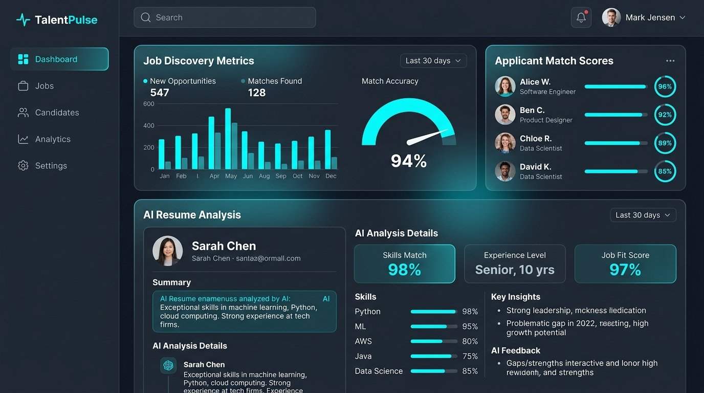
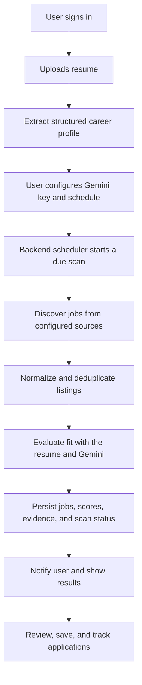

<div align="center">
  
  <h1>Agentic Jobs</h1>
  <p><strong>Discover smarter. Match with context. Keep your career moving.</strong></p>
  <p>An AI-powered, resume-aware job discovery and application-tracking workspace.</p>
  <p>
    <a href="https://agenticjobs.netlify.app/"></a>
    <a href="https://github.com/Talha-dotcom-hub/Agentic-Jobs"></a>
  </p>
  <p>
    
    
    
    
  </p>
  <p>
    
    
    
    
    
    
    
  </p>
</div>

---

## ✨ What is Agentic Jobs?

**Agentic Jobs** is a developer-oriented AI job-finding project designed to turn a candidate's resume into a reusable career profile, discover relevant vacancies, explain potential role fit, and organize the job-search workflow in one place.

The goal is to move beyond a basic job board: after a user configures their profile, AI credentials, and preferred schedule, the backend can discover new opportunities, evaluate them against the user's actual background, persist results, and notify the user when a scan completes—provided the backend worker and scheduling infrastructure are configured and running.

> **Important:** AI match scores are estimates for prioritizing opportunities. They are not hiring probabilities, guarantees, or a substitute for reviewing the job description yourself.

<div align="center">
  
  <br />
  <sub>Dashboard preview from the repository assets.</sub>
</div>

<p align="center"><a href="https://agenticjobs.netlify.app/"><strong>↗ Explore the deployed app</strong></a></p>

## 🧭 Contents

- [Product capabilities](#-product-capabilities)
- [How the agent works](#-how-the-agent-works)
- [Technology stack](#-technology-stack)
- [Architecture](#-architecture)
- [Quick start](#-quick-start)
- [Environment variables](#-environment-variables)
- [Supabase migrations](#-supabase-migrations)
- [Run, test, and build](#-run-test-and-build)
- [Deployment and background scans](#-deployment-and-background-scans)
- [Security and privacy](#-security-and-privacy)
- [Project structure](#-project-structure)
- [Known operational requirements](#-known-operational-requirements)
- [Team](#-team)
- [Contributing](#-contributing)
- [License](#-license)

## 🚀 Product capabilities

| Capability | Purpose | Configuration / notes |
|---|---|---|
| **Resume ingestion and profile memory** | Reads supported resume formats and extracts evidence-based skills, education, experience, and role signals for reuse. | PDF/DOCX/TXT processing depends on valid, text-readable documents; scanned PDFs may need OCR, which is not assumed here. |
| **AI-assisted job matching** | Uses Gemini to assess role alignment and surface matching evidence and potential skill gaps. | Requires a valid user-provided Gemini key or an intentionally configured server-side key. Scores should not be fabricated when AI evaluation fails. |
| **Multi-source discovery** | Normalizes supported public job feeds and configured job-board sources. | Actual source coverage depends on feeds, configured ATS boards, and optional provider credentials. |
| **Personal Gemini key (BYOK)** | Lets a self-hosting developer or user supply their own Gemini API key rather than automatically sharing the maintainer's quota. | Keys must be encrypted and kept server-side. Google model availability and quota still depend on the key's project. |
| **Model fallback** | Can try alternative configured Gemini models when a particular model is unavailable or rate-limited. | Fallback cannot bypass a project-wide quota limit, invalid credentials, or missing model access. |
| **Scheduled scanning** | Stores a scan schedule and processes due work on the backend, so a user does not need to keep the browser open. | Requires a continuously available worker or a reliable external scheduler/cron that invokes the protected backend. A schedule setting alone is not a 24/7 guarantee. |
| **Scan results and history** | Persists discovered opportunities and relevant scan status for later review. | Requires all listed Supabase migrations to be applied to the target project. |
| **Saved jobs and application tracking** | Helps organize interesting jobs, statuses, notes, and follow-up work. | Persistence should be tested against the configured database before production use. |
| **Notifications and Web Push** | Supports in-app/scan notifications and browser push where configured. | Web Push requires HTTPS, a service worker, stable VAPID keys, user permission, durable subscription storage, and a reachable backend. Browser, OS, and installed-app behavior vary. |
| **Responsive PWA experience** | Provides an installable web app with a cached application shell and offline status guidance. | Browser and platform install/push support varies. API responses and private user data are not runtime-cached. |
| **Separate demo experience** | Allows the UI to be explored with clearly marked sample data. | Demo/sample records are not live jobs and must not be treated as a real user's profile. |

## 🔄 How the agent works



1. **Create a profile:** sign in and upload a resume in a supported format.
2. **Extract evidence:** turn the resume into reusable profile data; unsupported or unreadable files should show an error rather than invented qualifications.
3. **Configure AI:** add a Gemini key in the product settings. Optional job-provider integrations can be configured separately.
4. **Choose a schedule:** set the desired frequency and make sure the backend scheduler/cron is deployed and reachable.
5. **Discover and evaluate:** configured sources return vacancies; matching uses available resume evidence and should keep failed/pending AI evaluations explicit.
6. **Recommendation threshold:** only validated numeric resume-match scores strictly greater than 85% are included in recommended results; a score of 85%, a missing score, or an invalid score is excluded.
6. **Review outcomes:** use recommendations, saved jobs, application tracking, history, and notifications to manage next steps.

## 🧰 Technology stack

<div align="center">
  
  
  
  
  
  
  
</div>

| Layer | Stack |
|---|---|
| Frontend | React 19, TypeScript, Vite 8 |
| UI and motion | Tailwind CSS 4, Motion, Lucide React |
| Backend | Node.js, Express 4, TypeScript via `tsx`, esbuild |
| Resume parsing | PDF.js, Mammoth (DOCX), text processing |
| Identity and persistence | Supabase Auth, PostgreSQL, Supabase Storage, Row Level Security |
| AI | Google Gemini via `@google/genai`; server-side key vault and model fallback logic |
| Job discovery | Public feeds, configurable ATS connector, optional Apify and RapidAPI integrations |
| Notifications | Web Push, VAPID, service worker / PWA |
| Testing | TypeScript compiler, Node.js test runner via `tsx` |
| Deployment shape | Netlify static frontend + Express backend hosted separately (current proxy target is Render) |

## 🏗️ Architecture

The frontend and backend are separate deployment concerns:

- **React + Vite frontend:** builds static web assets into `dist/`.
- **Express backend:** bundles to `server-dist/server.js` and handles authenticated APIs, resume workflows, job integrations, AI evaluation, and scheduled work.
- **Supabase:** manages authentication and persistence. Server-side elevated credentials must never be sent to the browser; private resources must be scoped to the verified user.
- **Gemini:** user-provided keys are the preferred BYOK path. Credentials must be encrypted at rest and decrypted only by the backend. A shared server key, if intentionally configured, consumes shared quota and requires usage limits.
- **Job providers:** public feeds may operate without a paid provider account; additional sources need valid configuration and can fail independently.
- **Scheduler:** the backend or external cron must invoke due work reliably, persist scan state, avoid duplicate runs, and retry failures with bounded backoff.

## ⚡ Quick start

### Prerequisites

- Node.js 24 (the version used during recent local validation) and npm.
- A Supabase project for real authentication and persisted data.
- A Gemini API key for AI matching.
- Optional provider credentials for Apify / RapidAPI.
- Backend environment configuration for secure Gemini key storage and scheduled scans.

### 1. Clone and install

```bash
git clone https://github.com/Talha-dotcom-hub/Agentic-Jobs.git
cd Agentic-Jobs
npm install
```

### 2. Configure environment

Create a local environment file from the template.

**Windows PowerShell**

```powershell
Copy-Item .env.example .env
notepad .env
```

**macOS / Linux**

```bash
cp .env.example .env
```

Populate only the variables needed for your environment. Never commit `.env`, credentials, resume files, or production data. The template contains placeholders, not usable credentials.

### 3. Configure Supabase

1. Create/select a Supabase project.
2. Configure the frontend URL and public anon key in the frontend environment.
3. Configure backend-only Supabase URL and secret/service-role key in the backend environment.
4. Enable email/password authentication and set the correct local and production redirect URLs.
5. Review and apply the repository's migrations exactly once, in dependency order; see [Supabase migrations](#-supabase-migrations).
6. Test account isolation and storage policies with separate test users before uploading personal resumes.

### 4. Start development mode

```bash
npm run dev
```

Open the local URL printed by the terminal. The development script starts the Express/Vite development entry point.

## 🔐 Environment variables

Variable names below are documented in `.env.example`. **Never put backend secrets in `VITE_*` variables**: Vite variables can be embedded into browser-delivered code.

| Variable | Use | Where it belongs |
|---|---|---|
| `VITE_SUPABASE_URL` | Supabase URL for the browser client | Frontend build environment |
| `VITE_SUPABASE_ANON_KEY` | Public Supabase client key for user sessions | Frontend build environment; pair with Auth and correct RLS |
| `SUPABASE_URL` | Backend Supabase project URL | Backend only |
| `SUPABASE_SECRET_KEY` | Elevated Supabase server operations (service-role equivalent in this project) | **Backend secret only** |
| `GEMINI_CREDENTIALS_ENCRYPTION_KEY` | Encrypts per-user Gemini API keys stored by the backend | **Backend secret only; keep stable** |
| `GEMINI_API_KEY` | Optional shared/server-side Gemini credential, if intentionally enabled | **Backend secret only; shared quota may be consumed** |
| `CRON_SECRET` | Protects privileged cron/scan endpoints | **Backend secret only** |
| `VAPID_PUBLIC_KEY` | Web Push public key | Backend config / public to the push client as required |
| `VAPID_PRIVATE_KEY` | Web Push signing key | **Backend secret only** |
| `VAPID_SUBJECT` | VAPID contact, such as a `mailto:` value | Backend config |
| `APIFY_API_TOKEN` (`APIFY_KEY` alias accepted) | Optional Apify connector credential | **Backend secret only** |
| `APIFY_ACTOR_ID` | Optional Apify actor selection | Backend config |
| `RAPIDAPI_KEY` (`RAPID_API` alias accepted) | Optional RapidAPI connector credential | **Backend secret only** |
| `RAPIDAPI_HOST` | RapidAPI product host (must end in `.p.rapidapi.com`) | Backend config; defaults to `linkedin-data-api.p.rapidapi.com` |
| `RAPIDAPI_SEARCH_PATH` | RapidAPI product's job-search path | Backend config; defaults to `/search-jobs` |
| `ENABLE_APPROVED_THIRD_PARTY_JOB_CONNECTORS` | Explicit opt-in for Apify/RapidAPI after provider terms and authorization are verified | Backend config; defaults to `false` |
| `RUN_SCHEDULER_WORKER` | Keep the scheduler loop in the API process; set `false` when deploying the separate worker service | Backend config |
| `PORT` | Server port (defaults to `3000`) | Hosting config |

Generate a strong encryption secret locally instead of copying a value from documentation:

```bash
node -e "console.log(require('node:crypto').randomBytes(32).toString('base64'))"
```

Set the output as `GEMINI_CREDENTIALS_ENCRYPTION_KEY` in the backend environment only. Keep it stable—rotating it without a planned key migration can make previously encrypted user keys unreadable. Never share the generated value in an issue, screenshot, README, or chat.

### Bring Your Own Key (BYOK)

For a self-hosted installation, each user/developer can provide their own Gemini key in the app. That keeps normal AI usage associated with the user's Google AI project and its quota. Apify and RapidAPI credentials are optional, but those connectors remain disabled until the operator explicitly opts in after checking provider terms and authorization. If the operator configures a shared `GEMINI_API_KEY`, it may become a shared fallback and must be protected with rate limits and usage controls.

Model fallback can help when an individual model is temporarily limited or unavailable, but it **cannot bypass project-level quota exhaustion, invalid keys, or missing access to a model**.

## 🗄️ Supabase migrations

The repository contains these schema/policy migrations:

1. `001_initial_schema.sql`
2. `002_scheduler_and_push.sql`
3. `003_structured_resume_memory.sql`
4. `004_account_deletion_and_policies.sql`
5. `005_harden_account_deletion_rpc.sql`
6. `20261026_user_gemini_credentials_and_discovered_jobs.sql`
7. `006_scan_runs_saved_jobs_and_scheduling.sql`
8. `20261029_scan_history_deduplication.sql`
9. `20261030_durable_scan_queue.sql`
10. `20261030_resume_storage_upload_limits.sql`

Apply them in the dependency order appropriate to your migration workflow. For manual SQL Editor setup on a new project, use the numbered base migrations first, then the account-deletion hardening migration, then the Gemini credential/discovered-job migration and scan-run/saved-job migration. Before applying anything to an existing project, inspect the migrations already applied—do not blindly rerun production SQL. Keep the database migration history consistent with your chosen workflow.

The migrations include user profiles, application data, schedules, push subscriptions/history, encrypted per-user Gemini credentials, discovered-job snapshots, scan-run persistence, and hardening for account-deletion RPC permissions. The contents of a migration file do **not** prove it has been applied to a particular live Supabase project.

The latest migrations add scan IDs and observation counts to discovered jobs, idempotency keys to notifications, rolling 24-hour scan-history retention, an atomic per-user scan enqueue function, retry/lease metadata, and private resume bucket upload limits. The API only returns the last 24 hours; a database trigger prunes expired history on insert, the backend worker prunes during its polling cycle, and a `pg_cron` job is installed when the extension is enabled. Saved jobs and discovered-job records are not removed when scan-history rows expire.

## 🧪 Run, test, and build

| Command | Purpose |
|---|---|
| `npm run dev` | Run the development app/server |
| `npm run lint` | TypeScript type-check (`tsc --noEmit`) |
| `npm run build` | Build the frontend and bundle the backend into `server-dist/` |
| `npm run worker` | Run the durable Supabase-backed scheduler as a standalone worker |
| `npx tsx --test tests/*.test.ts` | Run automated test suites |

**Latest local validation (29 Oct 2026):** TypeScript lint/type-check and production build passed, and **68 tests passed with 0 failures**. The production build reports a large JavaScript chunk warning for the existing application bundle. These are local checks, not a guarantee that every live provider, database migration, push subscription, deployment, or scheduled job is configured correctly.

### Run the built backend

After `npm run build`, the backend bundle is `server-dist/server.js`.

**Linux / Render start command:**

```bash
npm start
```

For local Windows PowerShell:

```powershell
$env:NODE_ENV = "production"
node .\server-dist\server.js
```

## 🚢 Deployment and background scans

### Frontend — Netlify

The current `netlify.toml` configures:

- Build command: `npm run build`
- Publish directory: `dist`
- SPA fallback and security headers
- `/api/*` proxy to `https://agentic-jobs-api.onrender.com/api/:splat`

Set the public frontend environment variables in Netlify's build environment. Changes to build-time variables require a new frontend deploy.

### PWA installation, updates, and offline behavior

The production build generates the web manifest and Workbox service worker. Static application assets are precached; `/api/*` is excluded from SPA navigation fallback and API responses, authentication state, and private records are not put in a shared runtime cache. When offline, the cached app shell may open and the UI warns that live discovery, AI matching, synchronization, and scans require a connection.

- **Android:** In a supported browser, use the app's Install button or browser menu and choose **Install app** or **Add to Home screen**, if offered. This installs the website as a PWA; it is not an APK.
- **Chrome and Edge desktop:** Use the Install button or the browser's install control/menu when offered. Ordinary browser access remains available.
- **iPhone/iPad:** In Safari, use **Share** → **Add to Home Screen**. iOS browsers do not universally expose the Android/Chromium install prompt.
- **Updates:** The app notifies the user when a service-worker update is ready and waits for an explicit reload action.
- **Web Push:** Permission is requested only after the user presses the enable button. A browser permission grant is not proof of a server subscription or successful delivery. Closed-app delivery depends on browser, OS, installation state, notification settings, a stable backend VAPID key pair, and an available delivery service; it is not guaranteed on every device.
- **Job providers:** Remotive public-feed and configured Greenhouse/Lever ATS endpoints are used where available. Apify and RapidAPI connectors are disabled unless `ENABLE_APPROVED_THIRD_PARTY_JOB_CONNECTORS=true` is explicitly set after verifying that provider terms, authorization, and rate limits allow the intended access. No login, CAPTCHA, paywall, or anti-bot controls are bypassed.

For production Web Push, configure a stable matching `VAPID_PUBLIC_KEY` and `VAPID_PRIVATE_KEY` in the backend's secret environment. The backend may use `server/data/vapid.json` for local development, but an ephemeral deployment filesystem is not durable storage for VAPID keys. One way to generate a pair locally is:

```bash
node -e "console.log(JSON.stringify(require('web-push').generateVAPIDKeys(), null, 2))"
```

Keep the private key only in the backend secret store. Changing either key invalidates existing browser subscriptions; do not generate a new pair on each deploy. Apply the push-subscription database migration before enabling subscription registration.

### Backend — Render / Node.js host

There is no checked-in `render.yaml` or Render service declaration, so the repository alone cannot confirm that a persistent Render worker is currently deployed. The API process includes an embedded worker by default; that worker stops whenever its API instance stops or restarts.

For durable scans independent of API restarts, configure two Render services from this repository:

**Web service**

- **Build command:** `npm install && npm run build`
- **Start command:** `npm start`
- **Environment:** set the API's required backend secrets. Set `RUN_SCHEDULER_WORKER=false` so the web process does not also poll the queue.

**Background worker**

- **Service type:** Background Worker (not a web service)
- **Build command:** `npm install && npm run build`
- **Start command:** `npm run worker`
- **Required environment:** `NODE_ENV=production`, `SUPABASE_URL`, and `SUPABASE_SECRET_KEY` (or `SUPABASE_SERVICE_ROLE_KEY`). Use the same Supabase project as the web service.
- **Optional runtime environment:** `GEMINI_CREDENTIALS_ENCRYPTION_KEY` and user/server Gemini credentials for matching; `VAPID_PUBLIC_KEY`, `VAPID_PRIVATE_KEY`, and `VAPID_SUBJECT` for push; approved source credentials and settings only when provider terms and usage rights have been confirmed.

Keep Supabase and all provider credentials in Render's backend environment only. The worker does not need `PORT`, frontend `VITE_*` values, or a browser session. Its database queue supports atomic per-user enqueue, leases, bounded retries, and recovery after a worker restart, provided the new migrations are applied.

Before enabling Apify, confirm the actor subscription/pricing and permitted use. This repository's verified default is the community actor `valig/linkedin-jobs-scraper`; it is paid per result and is not an official Apify actor. Before enabling RapidAPI, verify that the RapidAPI product associated with the key actually supports `RAPIDAPI_HOST` and `RAPIDAPI_SEARCH_PATH`. Neither provider has live credentials in this development environment, so endpoint authentication and returned listings are not live-verified here.

Verify the service URL, CORS/proxy behavior, health endpoint, and logs after deployment. A public `/api/*` proxy does not by itself keep the server alive or schedule scans.
Backend scans require a continuously available API worker. A sleeping or paused hosting instance cannot guarantee background execution; configure a durable always-on service or external scheduler if the deployment plan does not keep the worker running.

### Making scheduled scans genuinely autonomous

A static Netlify site cannot run a persistent Express worker. Scheduled scans require a backend that remains available or a dependable external scheduler that securely calls the protected cron endpoint. For production, verify:

- the cron/scheduler invocation runs at the selected frequency;
- `CRON_SECRET` is configured on the backend and caller;
- due scans are claimed atomically and stale locks can recover;
- scan state and results persist across process restarts;
- failures schedule a bounded retry instead of a hot loop;
- notifications are sent only when the persisted scan result justifies the completion message.

Do not advertise “24/7 autonomous” as a production guarantee until these conditions are verified on the actual hosting setup.

## 🛡️ Security and privacy

- Never commit `.env`, API keys, service-role credentials, cron secrets, VAPID private keys, real resumes, or production database exports.
- Treat `VITE_*` values as public because they may be bundled into browser code.
- Use verified Supabase user identity for private data access; never authorize a request based only on a client-supplied user ID.
- Keep resume files private and restrict read/write/delete access to their owner.
- Keep per-user Gemini credentials encrypted at rest, decrypt them only server-side, and do not return the raw key in an API response.
- Treat resumes, vacancy descriptions, and provider responses as untrusted input to AI prompts.
- Use request validation, rate limiting, bounded retries, and safe public error messages on API routes.
- Validate Supabase RLS/storage policies and account-deletion behavior with separate test accounts before using real personal data.
- Rotate any credential that is accidentally exposed and review Git history if a secret was committed.

## 📁 Project structure

```text
Agentic-Jobs/
├── public/                  # App icons, public assets, service worker
├── src/
│   ├── components/          # Shared UI, job cards, dialogs, layout
│   ├── context/             # Client state and data coordination
│   ├── lib/                 # Supabase and push client utilities
│   ├── pages/               # Public pages and authenticated app screens
│   ├── services/            # API client and demo/sample data
│   └── types/               # Shared TypeScript types
├── server/
│   ├── ai/                  # Gemini model fallback/orchestration
│   ├── credentials/         # Encrypted per-user AI credential vault
│   ├── middleware/          # Auth and request security
│   ├── push/                # Web Push service
│   ├── resume/              # Resume parsing and profile extraction
│   ├── scheduler/           # Scan engine and scheduler worker
│   └── sources/             # Public feeds, ATS, Apify, RapidAPI
├── supabase/migrations/     # Schema, RLS, and feature migrations
├── tests/                   # Unit/security/integration-style tests
├── server.ts                # Express API entry point
├── netlify.toml             # Frontend hosting and API proxy
├── vite.config.ts           # Vite/PWA build configuration
└── package.json             # Scripts and dependencies
```

## ⚠️ Known operational requirements

- **Providers are configuration-dependent:** an available connector class is not proof that a provider is connected or returning live jobs.
- **Model access varies:** configure model fallback based on the models accessible to your Gemini project; fallback cannot override provider quotas.
- **Live verification is separate:** passing unit tests and a build does not prove that live Supabase policies, Render settings, Netlify environment values, or push delivery work end-to-end.
- **24/7 scanning requires infrastructure:** a schedule in the UI is not enough without a running backend/worker or verified external scheduler.
- **Match scores are estimates:** never interpret them as a hiring outcome prediction.
- **License:** the repository currently has no `LICENSE` file. Until a license is added, don't assume the source is released under an open-source license or that broad reuse permission is granted.

## 👥 Team

<div align="center">
  <table>
    <tr>
      <td align="center" width="50%">
        <strong>M Talha Iftikhar</strong><br />
        <sub>Project developer</sub><br /><br />
        <a href="https://github.com/Talha-dotcom-hub"></a>
        <a href="https://www.linkedin.com/in/talha-dev-pk"></a>
      </td>
      <td align="center" width="50%">
        <strong>Laiba Asif</strong><br />
        <sub>Project developer</sub><br /><br />
        <a href="https://github.com/labii9412-cloud"></a>
      </td>
    </tr>
  </table>
</div>

## 🤝 Contributing

Issues, thoughtful reviews, and focused pull requests are welcome.

1. Fork the repository and create a feature branch.
2. Explain the problem and intended behavior before making a broad change.
3. Keep secrets, personal resumes, and production data out of commits.
4. Run the project checks and include the actual results in your pull request.

```bash
npm run lint
npm run build
npx tsx --test tests/*.test.ts
```

## 📄 License

No `LICENSE` file is included at this time. Until the maintainers add one, do not assume that this repository has an open-source license or that broad reuse, redistribution, or modification rights are granted.

---

<div align="center">
  
  <br />
  <strong>Agentic Jobs</strong>
  <br />
  <sub>Build a more organized, evidence-aware, human-directed job search.</sub>
  <br /><br />
  <a href="https://agenticjobs.netlify.app/">Live App</a> · <a href="https://github.com/Talha-dotcom-hub/Agentic-Jobs">Source Code</a> · <a href="https://www.linkedin.com/in/talha-dev-pk">Connect on LinkedIn</a>
</div>
