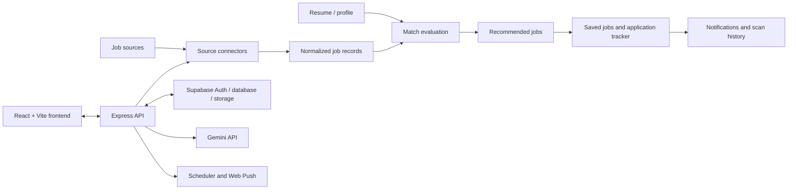

<div align="center">
  
  <h1>Agentic Jobs</h1>
  <p><strong>Discover smarter. Match with context. Keep your career moving.</strong></p>
  <p>An AI-assisted job discovery and application-tracking workspace built around your skills, resume, and career goals.</p>

  <p>
    
    
    
    
  </p>
  <p>
    
    
    
    
  </p>
</div>

---

## Overview

**Agentic Jobs** brings job discovery, resume-aware matching, and application tracking into one focused workspace. It combines a modern responsive interface with a separate Express API, Supabase-backed user data, and optional AI and job-source integrations.

Instead of treating every vacancy as an equal fit, Agentic Jobs is designed to help you review opportunities in the context of your skills and experience, understand match evidence and skill gaps, save promising roles, and keep your application pipeline organized.

> **Product principle:** AI match scores are estimates to support your review—not hiring probabilities, guarantees, or a substitute for your judgement.

<div align="center">
  
  <br />
  <sub>Dashboard preview included with the project assets.</sub>
</div>

## Contents

- [Highlights](#highlights)
- [How it works](#how-it-works)
- [Technology](#technology)
- [Architecture](#architecture)
- [Project structure](#project-structure)
- [Getting started](#getting-started)
- [Environment configuration](#environment-configuration)
- [Supabase setup](#supabase-setup)
- [Development commands](#development-commands)
- [Deployment](#deployment)
- [Security and privacy](#security-and-privacy)
- [Current limitations](#current-limitations)
- [Team](#team)
- [Contributing](#contributing)
- [License](#license)

## Highlights

| Capability | What it does |
| --- | --- |
| **Multi-source job discovery** | Normalizes listings from public feeds and Greenhouse/Lever ATS sources; optional Apify and RapidAPI integrations can extend discovery when configured. |
| **Resume profile memory** | Accepts a resume file, extracts structured career details, and helps keep a reusable profile of skills and experience. |
| **AI-assisted matching** | Uses configured Gemini access to evaluate role fit and surface supporting evidence and possible skill gaps. |
| **Demo experience** | Provides a clearly separated demo shell for exploring the UI without creating a fake authenticated user. Demo/sample content is not a substitute for live source data. |
| **Saved jobs and application tracking** | Organizes interesting vacancies and tracks applications through a dedicated workspace. |
| **Scheduled scan support** | Supports validated hourly and daily scan schedules through the backend scheduler. A production deployment must keep the backend/worker running and configure its credentials correctly. |
| **Notifications and Web Push** | Supports persisted notification/subscription workflows and browser push when the service worker, HTTPS, VAPID keys, and backend are correctly configured. |
| **Responsive PWA interface** | Includes installability/service-worker assets and layouts intended for desktop and mobile use. |
| **Access controls** | Uses Supabase authentication and row-level security policies for user-owned data. Security still depends on correct project configuration and policy review. |

## How it works



1. Job connectors collect and normalize available listings from configured sources.
2. A resume/profile provides context for role-fit evaluation.
3. Matching results help identify relevant skills, supporting evidence, and possible gaps.
4. You review jobs, save opportunities, and manage the status of applications.
5. When scheduled scans and push are configured on a running backend, scan events can be persisted and notifications delivered.

## Technology

| Layer | Technologies |
| --- | --- |
| Frontend | React 19, TypeScript, Vite 8 |
| Styling and motion | Tailwind CSS 4, Motion, Lucide React |
| Backend | Node.js, Express 4, TypeScript/tsx, esbuild |
| Authentication and data | Supabase Auth, PostgreSQL, Storage, Row Level Security |
| AI integration | Google Gemini via `@google/genai` |
| Job discovery | Public feeds, Greenhouse/Lever ATS connectors, optional Apify and RapidAPI connectors |
| Notifications | Web Push, VAPID, service worker/PWA tooling |
| Quality checks | TypeScript compiler, Node test runner through `tsx` |

## Architecture

The app is split into a **static frontend** and a **Node.js backend**.

- **Frontend:** Vite builds browser assets into `dist/`.
- **Backend:** The build script bundles the Express server into `server-dist/server.js`.
- **Database and identity:** Supabase provides authentication and persistent user data; apply and review Row Level Security policies before using real user information.
- **AI and integrations:** Gemini and optional external job providers are called by the backend when their credentials are configured.
- **Scheduler:** Scheduled scans require a running backend process or a correctly configured managed scheduling alternative. A static site host alone does not run the Express server or a persistent worker.

## Project structure

```text
agentic-jobs/
├── public/                 # Icons, public files, service-worker assets
├── src/
│   ├── components/         # Shared UI, job cards, forms, layout components
│   ├── context/            # App state and persistence integration
│   ├── hooks/              # Client hooks
│   ├── lib/                # Supabase and push client utilities
│   ├── pages/              # Public pages and authenticated app screens
│   ├── services/           # API client and sample data
│   └── types/              # Shared TypeScript types
├── server/
│   ├── middleware/         # Authentication and security middleware
│   ├── push/               # Web Push service
│   ├── resume/             # Resume parsing/profile extraction
│   ├── scheduler/          # Scan engine and worker
│   ├── security/           # URL validation utilities
│   └── sources/            # Public, ATS, Apify and RapidAPI connectors
├── supabase/migrations/    # Database schema and policy migrations
├── tests/                  # Automated tests
├── server.ts               # Express entry point and API routes
├── vite.config.ts          # Frontend/PWA build configuration
├── netlify.toml            # Static hosting and API proxy configuration
├── .env.example            # Environment variable template (no real secrets)
└── package.json            # Scripts and dependencies
```

## Getting started

### Prerequisites

- Node.js compatible with the versions used by the project (Node 24 was used for local validation).
- npm.
- A Supabase project for real authentication and persistence.
- A Gemini API key for live AI matching.
- Optional API credentials for extra job providers and Web Push.

### 1. Clone the repository

```bash
git clone https://github.com/Talha-dotcom-hub/Agentic-Jobs.git
cd Agentic-Jobs
```

### 2. Install dependencies

```bash
npm install
```

### 3. Configure local environment

Create a local environment file from the template.

**Windows PowerShell:**

```powershell
Copy-Item .env.example .env
notepad .env
```

**macOS / Linux:**

```bash
cp .env.example .env
```

Fill in only the credentials you actually use. Never commit `.env` or paste real credentials into issues, screenshots, logs, or public discussions.

### 4. Start the development server

```bash
npm run dev
```

Open the local URL printed by the terminal. The `dev` script starts `server.ts`, which configures the Express API and Vite development middleware.

## Environment configuration

The complete variable-name template lives in [`.env.example`](.env.example). Configure values through your local `.env` file or your hosting provider's environment settings.

| Variable | Purpose | Exposure |
| --- | --- | --- |
| `GEMINI_API_KEY` | Gemini model access for backend matching | **Server only** |
| `SUPABASE_URL` | Supabase project URL for the backend | Server configuration |
| `SUPABASE_SECRET_KEY` | Elevated Supabase server-side operations | **Server only — never expose to the browser** |
| `VITE_SUPABASE_URL` | Supabase URL used by the frontend client | Public frontend configuration |
| `VITE_SUPABASE_ANON_KEY` | Browser Supabase client key | Public by design; rely on Auth and strict RLS policies |
| `CRON_SECRET` | Protects privileged scheduled-scan/cron endpoints | **Server only** |
| `VAPID_PUBLIC_KEY` | Web Push public key | Public key; use the matching private key |
| `VAPID_PRIVATE_KEY` | Web Push signing key | **Server only** |
| `VAPID_SUBJECT` | VAPID contact subject, usually `mailto:you@example.com` | Public contact value |
| `APIFY_API_TOKEN` | Optional Apify connector credential | **Server only** |
| `APIFY_ACTOR_ID` | Optional Apify actor selection | Server configuration |
| `RAPIDAPI_KEY` | Optional RapidAPI connector credential | **Server only** |
| `PORT` | Server listening port; defaults to `3000` | Hosting configuration |

> **Important:** Vite variables prefixed with `VITE_` are embedded into browser-delivered code. Never place Gemini keys, Supabase secret/service-role keys, cron secrets, API-provider tokens, or VAPID private keys in a `VITE_` variable.

For production Web Push, keep the VAPID key pair stable between deployments. If keys are generated into a local file, make sure the production hosting setup has durable storage or provide stable keys through supported environment variables. Do not rely on an ephemeral filesystem for critical runtime state.

## Supabase setup

1. Create or select your Supabase project.
2. Configure the project URL and client key in the environment variables above.
3. Enable the email/password authentication provider and configure the correct site URL and redirect URLs for local development and the deployed frontend.
4. Review the SQL files in `supabase/migrations/` in numerical order:
   - `001_initial_schema.sql`
   - `002_scheduler_and_push.sql`
   - `003_structured_resume_memory.sql`
   - `004_account_deletion_and_policies.sql`
5. On a **new, empty project**, apply the migrations in order using the Supabase SQL Editor or your chosen migration workflow. On an existing project, inspect the current schema and applied migrations first—do not blindly re-run SQL against production data.
6. Verify Row Level Security policies and storage access rules with separate test accounts before uploading real resumes.

Resume files and profile data can contain personal information. Use least-privilege access, confirm that users can access only their own records, and avoid putting real resumes in demo or test data.

## Development commands

| Command | Purpose |
| --- | --- |
| `npm run dev` | Start the application in development mode |
| `npm run lint` | Run TypeScript type-checking (`tsc --noEmit`) |
| `npm run build` | Build the frontend and bundle the backend into `server-dist/` |
| `npx tsx --test tests/*.test.ts` | Run the automated test suites |

The project has been locally validated with the following results:

- TypeScript lint/type-check: passed
- Production build: passed
- Automated tests: **35 passed, 0 failed**

These results describe the local checks at the time of documentation; they are not a guarantee that every third-party service, credential, browser push subscription, or production deployment is configured correctly.

### Run the built backend locally

After `npm run build`, the backend bundle is located at `server-dist/server.js`.

**Windows PowerShell:**

```powershell
$env:NODE_ENV = "production"
node .\server-dist\server.js
```

**macOS / Linux:**

```bash
npm start
```

## Deployment

A complete deployment has two parts: **frontend hosting** and **backend hosting**.

### Frontend — Netlify

The current `netlify.toml` is configured for:

- Build command: `npm run build`
- Publish directory: `dist`
- SPA fallback routing and security headers

Import this GitHub repository into Netlify and configure the required public frontend environment variables in the Netlify project settings. Redeploy after changing build-time environment variables.

**Before production:** the `/api/*` proxy in `netlify.toml` currently contains a placeholder destination (`https://agentic-jobs-api.example.com/api/:splat`). Replace it with the real HTTPS base URL of your deployed backend before expecting frontend API calls to work.

### Backend — Node.js hosting

Deploy the repository as a Node.js web service on a host that can run Express. The current package scripts support these Linux-hosted commands:

- Build: `npm install && npm run build`
- Start: `npm start`

Set backend secrets in the hosting provider's environment-variable settings—not in GitHub. Make sure the platform's port handling, health checks, database connectivity, and logs are configured for the service.

### Scheduled scans and push notifications

A static Netlify site does not run the Express API or a continuous scheduler worker. For reliable scheduled scans, use a backend/worker deployment that can remain active, or implement a managed scheduler that securely calls the protected backend endpoint. Configure the cron secret on both ends, prevent overlapping jobs, and validate scan persistence after the browser has been closed.

For push notifications, use HTTPS, stable VAPID keys, persisted subscriptions, and a service worker served by the frontend. Test on each target browser/device; browser support and permission settings can differ.

## Security and privacy

- Keep `.env`, provider tokens, Supabase secret keys, cron secrets, and VAPID private keys out of version control.
- Use a public/anon Supabase client key in the browser only with correctly configured authentication and Row Level Security.
- Authorize backend requests using verified user identity; never trust a user ID supplied only by the client.
- Keep resume files private and restrict access to the authenticated owner.
- Validate external URLs before fetching them and apply appropriate request limits.
- Treat job descriptions and uploaded documents as untrusted input when passed to an AI model.
- Review migrations and RLS/storage policies before using production user data.
- Rotate any credential immediately if it is accidentally exposed.

## Current limitations

- **No live demo URL is listed here yet.** Add it after the frontend and backend are deployed and verified end-to-end.
- Optional Apify and RapidAPI integrations require their own credentials; public-feed fallback does not mean those providers are connected.
- Gemini matching requires valid server-side credentials. Sample/demo results must not be presented as live provider data.
- Automated tests cover selected behavior, not every possible live integration or production hosting failure.
- A scheduled scan is only autonomous while its backend/worker or managed scheduler is actually running.
- Match scores are guidance for prioritization and do not predict whether an employer will interview or hire a candidate.

## Team

<table>
  <tr>
    <td align="center" width="50%">
      <strong>M Talha Iftikhar</strong><br />
      <sub>Software Architect &amp; Backend Engineer</sub><br /><br />
      Designed the server-side architecture, Express API endpoints, Gemini AI evaluation schemas, and background job scheduling integration.<br /><br />
      <a href="https://github.com/Talha-dotcom-hub">GitHub</a> · <a href="https://www.linkedin.com/in/talha-dev-pk">LinkedIn</a>
    </td>
    <td align="center" width="50%">
      <strong>Laiba Asif</strong><br />
      <sub>Frontend Engineer &amp; UI Designer</sub><br /><br />
      Designed and built the responsive glassmorphism UI, interactive job drawer components, application tracker, and dashboard analytics.
    </td>
  </tr>
</table>

## Contributing

Contributions, issue reports, and focused improvements are welcome.

1. Fork the repository and create a feature branch.
2. Keep secrets and personal data out of commits.
3. Run the type-check, build, and tests before opening a pull request.
4. Describe the problem, the change, and the verification steps in the pull request.

```bash
npm run lint
npm run build
npx tsx --test tests/*.test.ts
```

## License

No `LICENSE` file is currently included in this repository. Unless a license is added, don't assume the source is released under an open-source license; contact the maintainers for reuse permission.

---

<div align="center">
  <strong>Agentic Jobs</strong><br />
  <sub>Built to make the job search more organized, evidence-aware, and human-directed.</sub>
</div>
